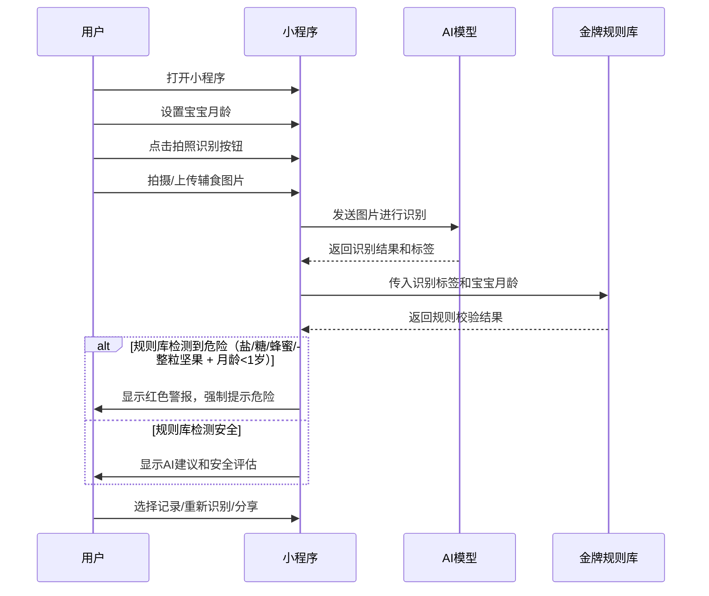
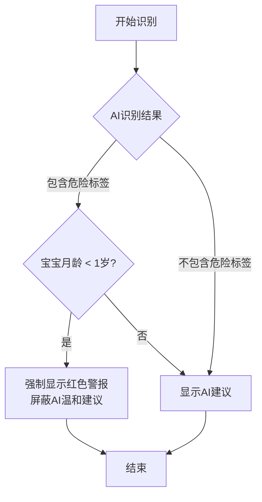

# 0-1岁婴儿辅食AI安全识别小程序 - 信息架构与交互设计

## 1. 信息架构（IA）

### 1.1 页面层级结构

```
┌───────────────────────────────────────────────────────────────────────────┐
│                                底部导航栏                                │
├───────────┬───────────────────┬───────────────────────────────────────────┤
│   首页    │   辅食记录        │                个人中心                  │
└───────────┴───────────────────┴───────────────────────────────────────────┘
        │               │                       │
        ▼               ▼                       ▼
┌───────────┐   ┌─────────────┐       ┌───────────────────┐
│ 拍照/上传页 │   │ 记录详情页  │       │   宝宝信息设置     │
└───────────┘   └─────────────┘       └───────────────────┘
        │                                       │
        ▼                                       ▼
┌───────────────────┐               ┌───────────────────┐
│   识别结果页      │               │   月龄设置页       │
└───────────────────┘               └───────────────────┘
        │
        ▼
┌───────────────────┐
│   月龄指南页      │
└───────────────────┘
```

### 1.2 导航设计

#### 1.2.1 底部Tab导航（核心导航）
- **首页**：核心功能入口，突出拍照识别按钮
- **辅食记录**：查看已添加的辅食记录
- **个人中心**：宝宝信息设置、系统设置等

#### 1.2.2 顶部导航
- 仅在非底部Tab页面显示返回按钮
- 页面标题居中显示

#### 1.2.3 页面内导航
- 卡片式布局，点击卡片进入详情页
- 按钮式导航，如首页的"拍照识别"按钮

### 1.3 核心功能路径

1. **AI辅食识别路径**：
   首页 → 点击拍照识别按钮 → 拍照/上传页 → 拍摄/选择图片 → 识别结果页 → 查看评估结果

2. **月龄设置路径**：
   个人中心 → 宝宝信息设置 → 月龄设置页 → 设置宝宝月龄 → 保存

3. **规则库校验路径**：
   （嵌入在AI识别流程中）
   拍照/上传页 → AI识别 → 规则库检测 → 生成结果 → 识别结果页

## 2. 交互设计（UX Design）

### 2.1 核心交互流程

#### 2.1.1 AI识别与规则库校验流程



#### 2.1.2 硬性拦截逻辑交互



### 2.2 页面交互设计

#### 2.2.1 首页
- **拍照识别按钮**：
  - 大尺寸、居中放置，视觉突出
  - 点击时有缩放动画反馈
  - 长按可切换拍照/相册模式
- **快速入口卡片**：
  - 圆角卡片设计，悬停时有轻微上浮效果
  - 点击后平滑过渡到对应页面
- **新手引导**：
  - 首次使用时显示半透明遮罩层
  - 分步引导用户完成核心操作
  - 支持跳过引导

#### 2.2.2 拍照/上传页
- **相机预览**：
  - 全屏相机界面，顶部显示返回按钮
  - 底部显示拍照按钮和相册选择按钮
  - 支持网格线开关
- **图片编辑**：
  - 支持简单裁剪，拖拽调整裁剪框
  - 确认按钮突出显示，点击后进入识别流程
- **加载状态**：
  - 识别过程中显示加载动画和进度提示
  - 文字提示："AI正在识别，请稍候..."

#### 2.2.3 识别结果页
- **结果展示**：
  - 顶部显示识别出的食材名称和匹配度
  - 安全等级使用色块+文字组合显示（绿色=安全，黄色=谨慎，红色=危险）
- **硬性拦截警报**：
  - 红色全屏警报，中央显示醒目的危险图标
  - 大号文字提示危险原因
  - 底部只有"重新识别"按钮
- **AI建议展示**：
  - 卡片式布局，分类展示建议
  - 可折叠/展开详细信息
- **操作按钮**：
  - 底部并排显示"记录"、"重新识别"、"分享"按钮
  - 点击"记录"后显示成功提示

#### 2.2.4 个人中心页
- **宝宝信息卡片**：
  - 显示宝宝头像（默认头像）、月龄
  - 点击可进入宝宝信息设置页
- **设置项列表**：
  - 图标+文字组合，右侧显示箭头
  - 点击后进入对应设置页
- **退出登录**：
  - 独立按钮，位于页面底部
  - 点击后弹窗确认

### 2.3 视觉交互规范

#### 2.3.1 动效设计
- **页面切换**：使用平滑的左右滑动过渡
- **按钮反馈**：点击时有缩放效果（0.95倍），松开后恢复
- **加载状态**：使用柔和的圆形加载动画
- **成功提示**：顶部弹出绿色提示条，3秒后自动消失
- **错误提示**：顶部弹出红色提示条，支持手动关闭

#### 2.3.2 色彩交互
- **安全状态**：使用辅助绿（#4CAF50）
- **危险状态**：使用警示红（#F44336）
- **谨慎状态**：使用警告黄（#FFC107）
- **正常状态**：使用主色调浅粉（#FCE4EC）

#### 2.3.3 手势交互
- **下拉刷新**：在列表页支持下拉刷新
- **滑动删除**：在辅食记录页支持左滑删除记录
- **长按操作**：支持长按保存图片、复制文字等

## 3. 核心功能实现要点

### 3.1 金牌规则库实现
- **规则存储**：使用JSON格式存储规则，便于维护和更新
- **规则匹配**：采用正则表达式或关键词匹配，确保快速准确
- **优先级处理**：严格按照规则库检测 > AI建议的优先级执行
- **动态更新**：支持后台动态更新规则库，无需小程序版本更新

### 3.2 AI识别流程优化
- **图片预处理**：压缩图片尺寸，提高识别速度
- **异步处理**：使用异步请求，避免页面卡顿
- **错误处理**：识别失败时显示友好提示，引导用户重新拍摄
- **缓存机制**：缓存近期识别结果，提高重复识别效率

### 3.3 月龄设置实现
- **存储方式**：使用小程序本地存储，确保快速访问
- **设置界面**：使用滑动选择器，直观便捷
- **验证机制**：确保设置的月龄在0-12个月范围内
- **默认值**：首次使用时默认设置为6个月

## 4. 可用性设计

### 4.1 极简设计原则
- **减少认知负担**：每个页面只聚焦一个核心功能
- **清晰的视觉层级**：使用色块、大小、间距区分信息重要性
- **简化操作流程**：核心功能最多3步完成

### 4.2 错误预防与处理
- **输入验证**：在月龄设置等页面进行实时验证
- **友好的错误提示**：使用通俗易懂的语言解释错误原因
- **恢复机制**：提供明确的重试或返回选项

### 4.3 无障碍设计
- **字体大小**：确保最小字体不小于14px
- **颜色对比度**：文字与背景对比度符合WCAG标准
- **操作区域**：按钮大小不小于44px×44px，便于点击

## 5. 原型设计建议

### 5.1 原型工具推荐
- 推荐使用Figma或墨刀进行高保真原型设计
- 可复用组件库：建立统一的按钮、卡片、导航组件

### 5.2 原型测试建议
- 邀请目标用户（0-1岁婴儿家长）进行 usability测试
- 重点测试核心流程：拍照识别 → 规则校验 → 结果展示
- 收集反馈并迭代优化设计

## 6. 技术实现建议

### 6.1 前端框架选择
- 推荐使用微信小程序原生开发，确保最佳性能和兼容性
- 或使用Taro框架，支持多端开发

### 6.2 状态管理
- 核心状态（如宝宝月龄、识别结果）使用全局状态管理
- 推荐使用mobx-miniprogram或wx-reduxs

### 6.3 性能优化
- 图片懒加载：列表页图片按需加载
- 缓存策略：合理使用小程序本地缓存
- 代码分包：将非核心功能拆分为分包，减少主包体积

---

## 7. 版本历史
- V1.0：初稿，2026年1月
